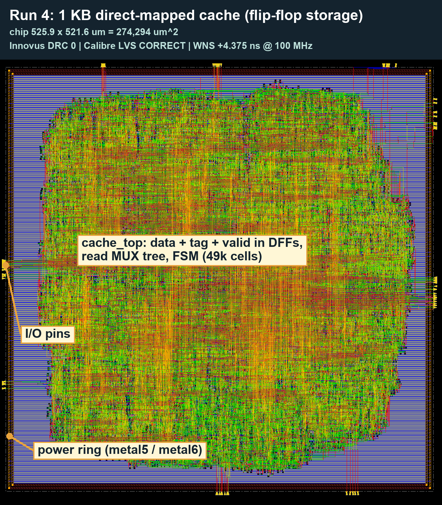
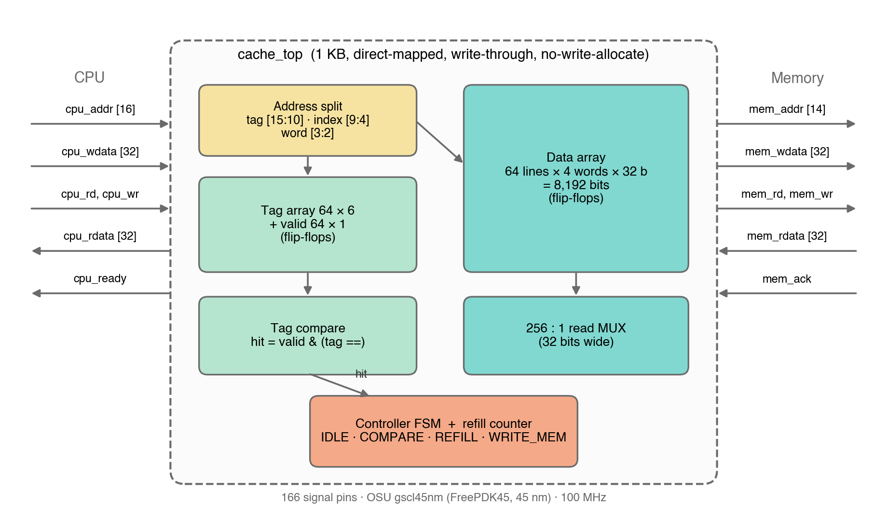
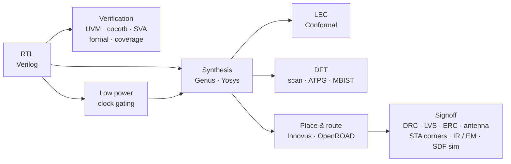
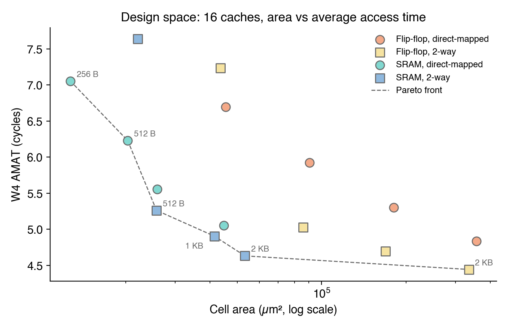

# 1 KB Cache: RTL to Signoff (45 nm)

[](https://github.com/ymt1001816-cyber/cache-rtl-to-signoff/actions/workflows/ci.yml)
[](https://github.com/ymt1001816-cyber/cache-rtl-to-signoff/actions/workflows/openroad.yml)

A 1 KB direct-mapped, write-through cache designed in Verilog and taken all the way to a DRC-clean, LVS-correct layout in FreePDK45 (45 nm),
then verified, made testable and made low-power: one design, every step of a chip flow.

Course project, EECE 7353 VLSI Design, Northeastern University, Fall 2026 · Meiyu Kuo

<p align="center"></p>

## Highlights

- **Verified three independent ways.** UVM (100% functional coverage, 4/4 planted bugs caught), cocotb with a Python reference model that checks memory traffic as well as data, and SymbiYosys k-induction proofs. LEC confirms RTL = netlist = layout.
- **Signed off, not just placed.** DRC 0, LVS correct, timing at SS / TT / FF corners, IR drop and EM, antenna and a custom ERC deck. [Four bugs](#bugs-that-only-signoff-found) were invisible until signoff.
- **Low power that stays testable.** Latch-based clock gating cuts real-activity power by **86%** (33.8 → 4.56 mW). It also broke scan: coverage fell to **84.3%**. A test-enable clock gate brings it back to **99.84%**, with a March C- MBIST built in.
- **Reproducible.** 25 open-source checks (including Verilator lint) run on every push. The open-source layout (OpenROAD) runs in GitHub Actions in about 20 minutes.

## Design

<p align="center"></p>

64 lines × 16-byte blocks, 4-state controller (IDLE, COMPARE, REFILL, WRITE_MEM), 100 MHz.
An AXI4-Lite slave wrapper puts the cache on a standard bus, with control and status registers (flush, hit / miss / write counters).

## Flow



## Results

**Verification** ([details](verification/README.md), [AXI](axi/README.md))

| Check | Result |
|---|---|
| UVM | 100% functional coverage, 20/20 seeds pass, 4/4 planted bugs caught; AXI4-Lite agent reuses the same sequences, scoreboard and coverage |
| cocotb | Random memory latency, reference model checks every hit/miss and the memory traffic; passes on the original, clock-gated and DFT RTL |
| Formal | k-induction proofs: no-write-allocate, bounded latency, AXI4-Lite handshake rules for any cache behavior |
| Registers (UVM RAL) | Register model with built-in reset and bit-bash tests; hit / miss / write counters match an independent reference; flush verified |
| Code coverage | Branch and expression 100%, toggle 99.2% |
| Equivalence | RTL = netlist = layout netlist (8,725 points); scan and DFT netlists equivalent too |
| Lint | Verilator `-Wall` clean on every RTL variant; each intentional warning is waived with its reason ([waivers](ci/lint_waivers.vlt)) |

**Physical design and signoff** ([details](layout/README.md), [open-source flow](openroad/README.md))

| Check | Result |
|---|---|
| Layout | DRC 0, LVS correct, 274,294 µm² (221,402 µm² at higher density, still clean) |
| Timing | SS / TT / FF corners pass at 100 MHz (SS setup +1.10 ns, worst hold +0.24 ns); SDF gate-level simulation passes |
| Power integrity | IR drop 6.1% → 2.2% with metal6 stripes; EM 0.50 MA/cm² (limit 1.8) |
| Extra signoff | Antenna clean, custom ERC clean |
| Open-source flow | OpenROAD on Nangate45: routing DRC 0, setup +6.42 ns, no hold violations |

**Design for test** ([details](dft/README.md))

| Check | Result |
|---|---|
| Scan + ATPG | 99.99% stuck-at; 32 chains cut tester cycles 31×; patterns pass gate-level simulation |
| Transition faults | Launch-on-shift 70.9% vs launch-on-capture 66.6%, with 41% fewer patterns |
| Clock gating vs scan | No test enable: 30 of 32 chains cannot shift, 84.3%. With test enable: 99.84%, LEC equivalent |
| MBIST | March C- (2,561 cycles) inside the design; finds memory faults and a stuck clock gate |

**Low power** ([details](synthesis/README.md))

| Check | Result |
|---|---|
| Clock gating | Real-activity power 33.8 → 4.56 mW (−86%), chip area −47%, all corners, SDF, LVS and LEC pass |
| Open item | 314 Calibre Well.2 errors at filler-cell boundaries and 20 ERC results in the clock-gated layout only |

## Bugs that only signoff found

1. **Floating set pins**: 50 flip-flop set pins were tied to 1 in the netlist but never wired to VDD. Innovus was clean; Calibre LVS caught it.
2. **A 0.5 nm gap**: the library LEF pins are on a 0.5 nm grid, the GDS on 1 nm. Three clock wires ended exactly on the LEF edge and were open in silicon. Fixed by moving LEF pin edges 2.5 nm inward (stays on the manufacturing grid).
3. **Floating wells**: a custom ERC deck found rows that held only filler cells, so their wells had no tap. DRC and LVS cannot see this (no transistors).
4. **A post-layout race**: the testbench memory changed data exactly at the clock edge; with clock-tree latency the refill was off by one word. Fixed by matching the SDC input delay.

## Design-space exploration

16 cache variants (4 sizes × flip-flop or SRAM storage × direct-mapped or 2-way) were synthesized, plus a write-back version; SRAM versions use OpenRAM macros.
An SRAM-based cache is 5.4× smaller but its read data arrives late in the cycle; a 2-way SRAM cache was the best balance.

<p align="center"></p>

## Repository layout

| Folder | Contents |
|---|---|
| [`rtl/`](rtl/) | Cache RTL: direct-mapped, 2-way, write-back, SRAM variants, clock-gated, DFT (test-enable clock gates + MBIST) |
| [`verification/`](verification/README.md) | Self-checking testbench, UVM + SVA, cocotb, formal, code coverage, verification plan |
| [`axi/`](axi/README.md) | AXI4-Lite wrapper, protocol testbench, SVA, formal proof, UVM agent |
| [`csr/`](csr/README.md) | Control / status registers, RTL testbench, UVM register model (RAL) |
| [`synthesis/`](synthesis/README.md) | Genus script, constraints, power with real activity, LEC, clock gating |
| [`layout/`](layout/README.md) | Innovus script, antenna LEF, IR-drop solver, ERC deck, signoff pipeline |
| [`dft/`](dft/README.md) | Scan insertion, ATPG, pattern simulation, MBIST, clock gating + scan |
| [`openroad/`](openroad/README.md) | Open-source RTL-to-GDS (OpenROAD-flow-scripts) |
| [`model/`](model/) | Python cache model (miss counts, AMAT, DRAM energy) |
| [`ci/`](ci/) | Open-source regression and lint waivers, run by GitHub Actions |

## Run it yourself

```bash
ci/regress.sh all     # Verilator lint, Icarus Verilog, cocotb, SymbiYosys (OSS CAD Suite): 25 checks
```

The same script runs on every push. The open-source layout runs from **Actions → openroad → Run workflow** (GDS and reports are saved as an artifact).
The Cadence flows need a licensed install; PDK and standard cells (FreePDK45, OSU gscl45nm) are not included, and scripts use the university's tool paths.

**Tools:** Cadence Xcelium, Genus, Innovus, Conformal, Modus, Spectre · Siemens Calibre · cocotb · SymbiYosys · OpenROAD-flow-scripts · Verilator · Icarus Verilog · OpenRAM · Python

## My role and AI use

I wrote the RTL, the testbench and UVM components, the SVA properties, the clock-gating RTL, the MBIST controller, the DFT version (test-enable clock gates, MBIST integration), the AXI4-Lite wrapper, its SVA and formal properties, the AXI UVM agent, the cocotb reference model, driver, scoreboard and random test, and the CSR block with its UVM register model and adapter.
As allowed by the course, I used an AI assistant (Claude) to help set up the tool flows and write several scripts
(layout, signoff, scan insertion, ATPG, IR-drop model, ERC deck, formal environment assumptions, the MBIST fault-injecting memory and testbench, the DFT test-mode testbench, the cocotb memory model, coverage and build setup, the OpenROAD flow setup, the CSR testbench, RAL environment and tests, the lint waivers, the AXI testbench) and to draft documentation.
I ran, reviewed and can explain every step.
